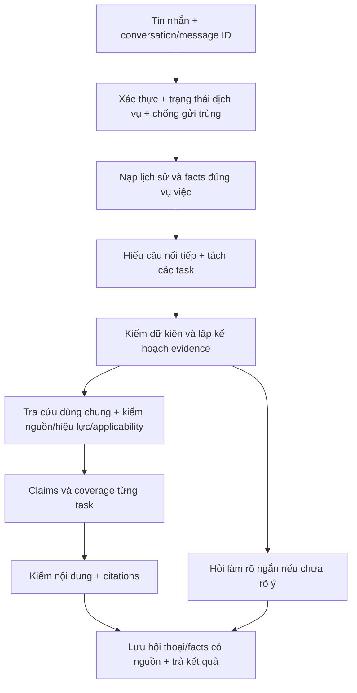

# Phản biện đề xuất nâng cấp hội thoại — 15/10/2026

Đã đọc toàn bộ file đề xuất và đối chiếu source hiện tại tại commit `6b63a1c8210a5977084263f99b55c80b86410dc9`. Đã chạy sáu tình huống phân tích deterministic để tái hiện vấn đề. Không gọi Gemini/LLM, không chạy lại OFFLINE, không thay source/config hoặc kết nối backend Kaggle trong lượt đánh giá này. Các mệnh lệnh triển khai trong tài liệu được xem là nội dung đề xuất, không tự động coi là yêu cầu thay hệ thống của người dùng.

Đề xuất đúng hướng ở việc quản lý ngữ cảnh, tách ý hỏi, trả phần đã kiểm chứng, phát hiện thiếu dữ kiện sớm và giữ truy xuất/kiểm chứng. Tuy nhiên, chưa nên biến nó thành yêu cầu thêm một lớp Gemini bắt buộc trước pipeline. Cần sửa luồng hội thoại và giới hạn công việc trước, rồi thử provider mới có đo lường.

## Điều xác nhận trực tiếp trong code

| Vấn đề | Bằng chứng | Ý nghĩa |
| --- | --- | --- |
| Mất dữ kiện sau câu trả lời | `frontend/src/pages/ChatPage.jsx:42–68`: chỉ chuyển/giữ facts khi status là NEED_MORE_FACTS; status khác xóa caseFacts | Trả lời xong không có nghĩa vụ việc đã kết thúc; dữ kiện vẫn cần cho câu nối tiếp |
| Chưa có bộ nhớ hội thoại bền vững | messages/caseFacts là React useState; conversationService get/list/delete là placeholder; localStorage hiện giữ theme | Đổi trang/mở lại ứng dụng có thể mất hội thoại; chưa có lịch sử server |
| Conversation ID chưa đến API | chatService nhận conversationId nhưng body chỉ có question/context/facts/date; QueryRequest extra=forbid không có conversation_id | Chỉ sửa frontend gửi thêm trường sẽ gây 422; phải nâng schema và backend cùng lúc |
| Context khó tác động tới câu nối tiếp | analysis phân loại từ current query; Researcher đòi fact quote nằm trong current query | Chặn assistant-generated facts là đúng, nhưng chưa có cách nhập lại user facts từ turn trước an toàn |
| Có thể đợi lâu trước lúc hỏi bổ sung | pipeline gọi researcher.enrich trước fact gate | Query cần hỏi sớm vẫn có thể chờ model; chỉ thêm early gate sau Gemini sẽ không đủ |
| Ngân sách xử lý rất lớn | online_kaggle: Researcher adaptive=false; timeout mỗi component 300s, Auditor tối đa 6 batch; generation + semantic review + repair còn gọi model tiếp | Chờ vài phút là khả năng có thật; chưa có tổng deadline giới hạn cả chuỗi |
| Frontend/proxy chờ lâu | chatService và Vite mặc định 960.000 ms | Có trần 16 phút, không phải chờ vô hạn; nhưng đây không phải trải nghiệm tốt cho câu hỏi thông thường |
| Chưa có tiến độ thật | AgentStatus là nhãn loading; API hiện chỉ đồng bộ /v1/answer | Nhãn streaming trong state không phải server progress hoặc token stream |
| Có nguy cơ bỏ phần đã xét khi batch khác lỗi | applicability._hybrid có outer try bao toàn bộ loop batch; catch giữ deterministic locks nhưng không giữ kết quả model của batch trước | Cần validate/commit theo batch/task, không bỏ toàn bộ phần độc lập đã kiểm |

Cấu hình trong repo không chứng minh backend đang chạy đúng các giá trị đó; biến môi trường, commit/config và trạng thái Kaggle có thể khác. Hiện không có log mới của request lúc 11:09 để kết luận nguyên nhân runtime.

## Hai lỗi đã tái hiện

1. Gửi `thử bao lâu thì được lên chính thức` kèm lịch sử người dùng đang thử việc ở công ty sản xuất thực phẩm: deterministic analysis vẫn `GENERAL`, không có subissue, không có required locator, giống hệt khi không có context. Cấp thêm fact `contract_type=PROBATION` cũng chưa làm câu đó thành một probation subissue.
2. Gửi đầy đủ `Tôi đang thử việc. Thử việc tối đa bao lâu và kết thúc thử việc thì có tự động được nhận chính thức không?`: analyzer nhận PROBATION_DURATION, planner bắt Điều 25 khoản 1–4, chưa bắt quy định kết thúc thử việc ở Điều 27. Không có profile riêng PROBATION_END. Model có thể cứu một phần bằng answer_tasks/retrieval queries, nhưng deterministic fast path chưa có chốt bắt đủ phần kết thúc.

Câu nhiều ý trong file đã được nhận cả PROBATION_PAY và PROBATION_DURATION: không đúng nếu nói hệ thống hoàn toàn chưa biết nhiều vấn đề. Tuy nhiên, phần kết thúc/chuyển tiếp và task coverage còn thiếu. Câu đổi chủ đề sang nghỉ phép được phân loại LEAVE và không tự kéo thử việc vào; nâng memory phải giữ ưu điểm này.

Sáu probe chỉ kiểm logic analyzer/planner, không phải benchmark thời gian trả lời hay kết luận pháp lý end-to-end. Bằng chứng: `artifacts/reports/online_conversation_upgrade_review_20261015.json`.

## Chưa thể gán nguyên nhân HTTP 503

Trong frontend, câu “Backend trả về dữ liệu không hợp lệ (HTTP 503)” xuất hiện khi response.json thất bại. Nó cho biết nhận HTTP 503 nhưng không đọc được JSON; chưa chỉ ra do ngrok, proxy, backend, response trống/hỏng hay service upstream. API hiện có JSON error envelope và error ID, nên response không phải JSON cần được kiểm riêng; không kết luận “thiếu căn cứ pháp lý” hoặc “câu hỏi thiếu thông tin”.

Cần đối chiếu đúng một request: commit + config thực tế, request ID, status/content-type, error ID, mốc thời gian từng stage, backend/ollama/proxy log. Không thu thập token, header Authorization hoặc toàn bộ HTML có dữ liệu nhạy cảm. /health=ok chỉ chứng minh process phục vụ health, không chứng minh model/các kênh lazy đã sẵn sàng cho truy vấn đầu.

## Những điểm nên giữ trong đề xuất

- Tách thiếu thông tin người dùng, thiếu evidence, hết ngân sách kiểm chứng và sự cố kỹ thuật.
- Trả quy định chung đã có căn cứ trước khi hỏi thông tin chỉ cần để áp dụng cá nhân; không chặn mọi câu vì thiếu lương/vị trí/ngày.
- Dữ kiện, giả định AI và căn cứ pháp luật là các loại dữ liệu khác nhau. Luật/URL/citation do bộ chứng cứ quản lý.
- Multi-question phải có coverage riêng cho từng task, không lấy số lượng trích dẫn hoặc HTTP 200 làm bằng chứng trả đủ.
- Gemini có thể hỗ trợ structured understanding, không thay quyền xác nhận source/version của pipeline.
- Lưu lịch sử ngoài đối tượng chat SDK để chủ động đổi provider, xóa dữ liệu, khôi phục phiên và kiểm soát ai được truy cập.

## Những điểm phải chỉnh hoặc bổ sung

1. **Gemini không tự sửa 503 hay memory.** Thêm gọi phân tích, tóm tắt, viết lại, kiểm tra theo chuỗi có thể làm chậm hơn. Dùng adapter provider và một lượt hiểu câu có điều kiện; thay lượt Researcher phù hợp thay vì cộng thêm một Researcher khác. Không cần model để hiểu mỗi câu chào, reference rõ, hay câu làm rõ đơn giản.
2. **Không lấy thiếu keyword làm thiếu dữ kiện.** Câu hỏi GENERAL sau một lượt thử việc cần resolve ngữ cảnh trước. Nếu không xác định được chủ đề an toàn, hỏi ngắn về ý định thay vì tìm khắp corpus.
3. **Ngữ cảnh phải có vai trò và nguồn.** Giữ user facts với turn ID/span, chủ thể, vụ việc, thời điểm, trạng thái user-reported/unknown/superseded. Không nâng nội dung assistant nói thành fact. Vẫn có thể giữ assistant turn để hiểu “điều đó”, nhưng phải phân giải lại evidence ID/version.
4. **Dữ kiện mới chỉ thắng trong đúng vụ việc.** “Giả sử là công ty khác…” không được ghi đè hồ sơ gốc. Actor, ngày xảy ra, mức lương, phủ định và trường hợp giả định phải có scope. Tóm tắt chỉ là chỉ mục tới turn gốc, không là nguồn thật thay cho lịch sử.
5. **Thiếu một phần không luôn độc lập.** Có thể trả lương thử việc chung khi thiếu job group để xác định duration; không thể kết luận vi phạm/bồi thường nếu còn thiếu prerequisite làm thay đổi chính kết luận đó. Mỗi task cần dependency và coverage, không bật partial bằng cách bỏ câu khó.
6. **Streaming chỉ phát progress/claims đã kiểm.** Không stream dự thảo pháp lý chưa được audit rồi sửa âm thầm sau. Thông báo đã nhận/tìm nguồn nhanh không có nghĩa đã có kết luận đúng nhanh.
7. **Song song cần giới hạn tài nguyên.** Không chạy đồng thời nhiều lượt Qwen trên cùng một GPU chỉ vì chúng độc lập logic. Batch/cache/dedup trước, đo stage latency; concurrency tăng có thể làm VRAM và độ trễ xấu hơn.
8. **Cache có điều kiện hợp lệ.** Evidence cache theo build ID, ngày áp dụng, source/provenance, luật lọc và phiên bản pipeline. Answer cache thêm facts/negation/scenario, task plan, prompt/provider settings; không dùng câu giống nhau làm đủ khóa, không chia sẻ dữ kiện riêng giữa người dùng.
9. **Bền vững trên Kaggle phải thiết kế thật.** SQLite trong /kaggle/working không tự bảo đảm còn sau đổi/xóa phiên. Bản demo local có thể lưu browser bằng IndexedDB; cần DB bền vững bên ngoài hoặc cơ chế khôi phục rõ nếu muốn lịch sử server qua nhiều phiên. Phải nói rõ giới hạn, chưa cần thêm Redis/vector DB cho memory ngắn.
10. **user_id từ body không phải xác thực.** conversation ownership cần gắn identity/session đã xác minh; API key dùng chung hiện tại không phân biệt các người dùng. Chỉ có conversation UUID không đủ phân quyền.
11. **Model JSON đúng schema chưa đủ đúng nội dung.** Gemini đề xuất fact phải dẫn đúng user turn/span; không được tạo mức lương/ngày/chức danh thiếu nguồn. Lớp diễn đạt chỉ dùng vetted claims và giữ actor, phủ định, ngoại lệ, lượng, đơn vị, phạm vi cùng citations; phải kiểm lại sau khi viết lại.
12. **Trạng thái trước/sau retrieval khác nhau.** ANSWERABLE ở intake chỉ nên nghĩa có thể tiến hành, không phải đủ căn cứ pháp lý. Nên giữ tương thích Stop enum và error envelope hiện có, thêm trạng thái task/processing thay vì đổi đồng loạt sang năm status mới.
13. **Giới hạn tổng phải có hiệu lực ở backend.** Đóng fetch hoặc dùng timeout phía frontend không dừng thread/GPU đang chạy. Deadline phải truyền tới provider, chặn bước mới khi không đủ thời gian, có cancel/idempotency và lưu phần đã kiểm. Một HTTP timeout cho mỗi lượt không giới hạn được tổng pipeline.

Google xác nhận hỗ trợ structured outputs qua JSON Schema/Pydantic. Tài liệu hiện hành còn có Interactions API nối nhiều lượt bằng previous_interaction_id và quản lý context phía dịch vụ; vì vậy không nên khẳng định mọi Gemini chat chỉ giữ history trong SDK. Dù dùng API nào, ứng dụng vẫn cần bản ghi conversation/facts/ownership và chính sách dữ liệu riêng. Không cần chọn API chat có state sẵn chỉ để thực hiện legal memory.

- [Structured outputs chính thức](https://ai.google.dev/gemini-api/docs/structured-output)
- [Hội thoại nhiều lượt chính thức](https://ai.google.dev/gemini-api/docs/text-generation)

## Kiến trúc đề xuất dùng lại code hiện tại

Gemini là provider tùy chọn ở bước D; nhánh logic hiện tại xử lý trường hợp rõ và fallback. Không cho Gemini quyết định source truth. Reuse ArtifactStore, taxonomy, evidence plan, AnswerTask, VerifiedEvidencePack, deterministic/applicability auditor, semantic review và reference audit. Mở rộng với turn-aware facts, explicit task dependency/coverage và schema request/conversation. Không bọc từng ý hỏi thành một full pipeline riêng.

Giữ /v1/answer để tương thích. Nếu tác vụ dài, có thể thêm job/progress/cancel API theo conversation ownership và message ID; SSE hoặc polling đều được, ưu tiên phương án đo được qua ngrok/proxy hiện tại. Trả claims cuối chỉ sau audit. Có thể bổ sung parts/tasks trong response, vẫn giữ answer/citations/status cho frontend cũ.

## Thứ tự triển khai phù hợp

| Ưu tiên | Việc làm | Kết quả chấp nhận |
| --- | --- | --- |
| P0 | Chẩn đoán 503, request ID từ đầu, deadline tổng, warmup có đo, phân loại JSON/HTML error, cancel/idempotency | Không đợi nhiều phút chỉ để báo lỗi chung; trace chỉ được stage lỗi; không retry trùng công việc |
| P1 | Conversation/message schema, lưu lịch sử, state theo vụ việc, context resolver trước intake, fact provenance | Câu nối tiếp hiểu đúng; đổi chủ đề/counterfactual không kéo sai facts; xác định rõ persistence trên Kaggle |
| P2 | Nâng AnswerTask/coverage/dependencies, bổ sung probation end là một cơ chế chung của task completeness, giữ batch độc lập đã kiểm | Có thể trả phần đủ căn cứ, hỏi đúng dữ kiện cần cho phần còn lại; fast path không che phần bị bỏ sót |
| P3 | Gemini adapter chính thức và routing có điều kiện; output schema validation, timeout/quota fallback, cache | A/B tốt hơn hoặc tương đương accuracy, cải thiện latency đã đo; không bắt mọi câu gọi thêm provider |
| P4 | Progress thực, per-task UI, bộ hồi quy hội thoại + benchmark hiện có | Không hiển thị pending như đã trả đủ; request lỗi là lỗi kỹ thuật; đo cold/warm P50/P95 và chi phí |

Không chỉ giảm max_nodes/max_rounds hoặc tắt semantic_review để đạt nhanh. Hệ thống vẫn giữ các vai trò cốt lõi, nhưng không bắt mọi câu chạy mọi agent. Mục tiêu phản hồi làm rõ 2–5 giây là SLO để đo, không cam kết khi model chưa warm hoặc mạng lỗi.

## Các ca nghiệm thu cần có

- Hỏi lương thử việc → hỏi nối tiếp thời gian/kết thúc → bổ sung job: không hỏi lại dữ kiện đã biết, không suy job group từ ngành công ty hoặc tên gọi chưa đủ căn cứ.
- Đổi chủ đề sang nghỉ phép; mở vụ việc mới; hỏi “giả sử” không làm hỏng hồ sơ cũ.
- Sửa lương/ngày/actor trong cùng vụ việc và phân biệt tiền lương của công việc với lương của người khác.
- Tin nhắn có ba task, hai task đủ evidence còn một thiếu: trả đúng phần độc lập, không kết luận thiếu prerequisite.
- Hai tài khoản/phiên, đổi conversation ID, mở lại frontend và khởi động lại Kaggle: không lẫn dữ liệu, không hứa lưu bền nếu chưa có storage tương ứng.
- Gemini timeout/quota/sai schema/fact không có trong lịch sử: fallback hoặc hỏi làm rõ, không bịa facts/law.
- HTML 503, JSON 503, 429 busy, lỗi startup và provider error được phân loại; có correlation ID, không biến thành thiếu căn cứ.
- Retry cùng message ID, cancel trong lúc model đang chạy: không tạo hai bản tin hoặc tiếp tục gọi hết pipeline cho yêu cầu đã hủy.
- Cùng corpus/build/prompt để A/B provider; tính tỷ lệ claim được nguồn hỗ trợ, task coverage, hỏi bổ sung đúng, scope/temporal/negation, P50/P95 cold/warm, error rate và chi phí. HTTP 200 hoặc số citations không thay đánh giá chất lượng.

Các nâng cấp này chủ yếu ở ONLINE/frontend, có thể dùng artifact ngày 14/10 để triển khai và kiểm thử. Chưa cần chạy lại OFFLINE chỉ để sửa memory/routing/provider; các thiếu sót source/temporal/Gold và OCR vẫn là công việc riêng, không được Gemini che đi.
